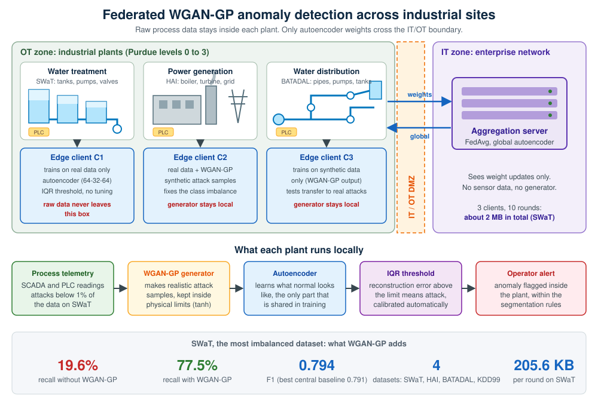
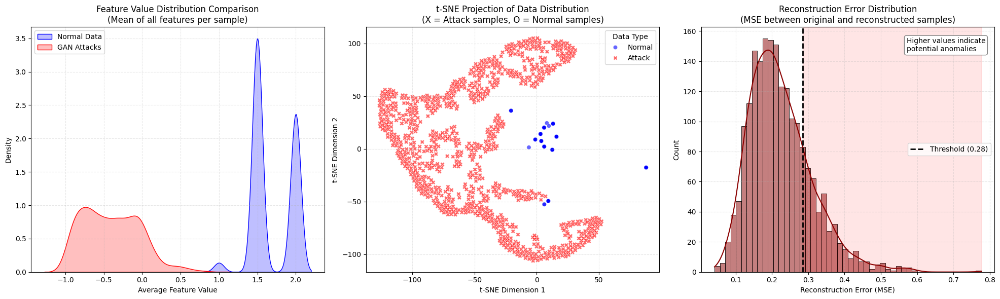

# A Decentralized Federated WGAN-GP Framework for Anomaly Detection in Industrial Control Systems

**Published in IEEE Access (2026)**  
📄 [https://ieeexplore.ieee.org/abstract/document/11569888/](https://ieeexplore.ieee.org/abstract/document/11569888/)  
DOI: `10.1109/ACCESS.2026.3704897`

> Veysel Alevcan · Mohammad Furqan Ali · Yakubu Tsado · Serra Atal · Paulo Correia · Christoforos Ntantogian · Bamidele Adebisi · Luís Miguel Campos



---

## 📌 Project Overview

This repository contains the code, trained models, and notebooks associated with the above publication. The work addresses a fundamental challenge in ICS/SCADA security: anomaly detectors trained on a single site's data fail to generalize, while centralizing operational data across sites is infeasible due to privacy and regulatory constraints.

The proposed framework combines **Federated Learning (FL)** with **WGAN-GP generative augmentation** to solve two distinct problems simultaneously:
- Data heterogeneity across federated clients (non-IID distributions)
- Severe class imbalance in ICS attack datasets (attack class < 1% on SWaT)

---

## 📊 Visualization Summary

<div align="center">
  
</div>

**Figure Explanation:**

| Panel | Description |
|-------|-------------|
| **Left: Feature Value Distribution** | Mean feature values per sample for Normal (blue) vs. WGAN-GP synthetic attack (red) samples. Statistical separation confirms anomaly discriminability. |
| **Center: t-SNE Projection** | Dimensionality reduction showing clear clustering of Normal (blue circles) vs. Attack (red crosses) samples in latent space. |
| **Right: Reconstruction Error (MSE)** | Autoencoder reconstruction error histogram. IQR-based threshold separates normal from anomalous samples without manual tuning. |

---

## 🧬 Methodology

**1. Federated Learning Setup — Three-Client Architecture**

Each client trains locally without sharing raw data. Only autoencoder weight updates are transmitted to the aggregation server via FedAvg. Generator weights never leave the client.

| Client | Training Data Composition |
|--------|--------------------------|
| C1 | Real operational data only |
| C2 | Real + synthetic mixture |
| C3 | Synthetic data only (WGAN-GP output) |

**2. WGAN-GP Generative Augmentation**

Each client trains a WGAN-GP generator on its local process telemetry. The generator learns the statistical and temporal structure of the real data and oversamples the attack minority class for local training only.

- Synthetic data validated with Wasserstein-1 (W₁) distance and Kolmogorov-Smirnov (KS) statistic per feature
- All synthetic samples validated within physical process boundaries (tanh output layer)
- Mean W₁ < 0.004, Max W₁ < 0.02 across all features (SWaT and HAI)

**3. Autoencoder Architecture**

```
Input (d) → Dense(64) → Dense(32) → Dense(64) → Output (d)
```
Swish activations · Batch Normalization · Dropout · IQR-based adaptive threshold

**4. Anomaly Detection**

- Anomaly score: per-sample reconstruction loss (MSE)
- Threshold: IQR-based, calibrated automatically per dataset — no manual tuning
- Metrics: Accuracy, Precision, Recall, F1, AUC-ROC

---

## 📁 Datasets

Evaluated across four ICS benchmarks spanning water treatment, electric power, and network intrusion domains:

| Dataset | Domain | Features | Attack Ratio |
|---------|--------|----------|-------------|
| SWaT | Water treatment (SUTD) | 51 | < 1% |
| HAI | Electric power HIL testbed | 59 | ~6% |
| BATADAL | Water distribution network | 43 | ~6% |
| KDD99 | Network intrusion (cross-domain) | 38 | ~20% |

- SWaT / HAI: [iTrust, SUTD](https://itrust.sutd.edu.sg/itrust-labs_datasets/dataset_info/)
- BATADAL: [batadal.net](http://www.batadal.net/)
- KDD99: [UCI KDD Archive](http://kdd.ics.uci.edu/databases/kddcup99/)

---

## 🧠 Key Results

**Ablation Study — SWaT (most class-imbalanced dataset):**

| Configuration | F1 | Recall |
|--------------|-----|--------|
| C0: Best centralized baseline (IF / LOF / OC-SVM) | 0.791 | — |
| C1: FL + Autoencoder, no WGAN-GP | 0.286 | 0.196 |
| C2: FL + WGAN-GP (proposed) | **0.794** | **0.775** |

Removing WGAN-GP collapses Recall by **57.9 pp** on SWaT. On HAI and BATADAL, FL drives most of the gain with WGAN-GP adding marginally — consistent with their more balanced class distributions.

**Communication overhead (K=3 clients, T=10 rounds):**

| Dataset | Per-round traffic | Total (10 rounds) |
|---------|------------------|-------------------|
| SWaT | 205.6 KB | 2.01 MB |
| HAI | 278.1 KB | 2.72 MB |
| BATADAL | 199.5 KB | 1.95 MB |
| KDD99 | 223.7 KB | 2.18 MB |

Generator weights are never transmitted — only autoencoder updates.

---

## 📦 Repository Layout

```
.
├── notebooks/   Training and evaluation notebooks (Google Colab)
├── src/         Core federated learning pipeline (Python)
├── models/      Trained models
│   ├── wgan/    WGAN-GP generators and discriminators per dataset
│   └── *.h5     Global federated autoencoders
├── docs/figures Figures used in this README
└── requirements.txt
```

| Path | Description |
|------|-------------|
| `notebooks/SWaT_2015_Data_FL_Wgan_compare_result_other_ML_model.ipynb` | SWaT FL + WGAN-GP training and evaluation |
| `notebooks/HAI_20_07_data_FL_WGAN_compare_result_other_ML_model.ipynb` | HAI equivalent |
| `notebooks/BATADAL_Data_FL_Wgan_compare_result_other_ML_model.ipynb` | BATADAL equivalent |
| `notebooks/KDD_Data_FL_Wgan_compare_result_other_ML_model.ipynb` | KDD99 equivalent |
| `notebooks/SWaT_Attack_Analysis_with_Federated_Learning_and_GANs.ipynb` | Attack analysis and visualization |
| `notebooks/SWaT_July2019_FL_Anomaly_Detection_and_GAN_Fake_Injection.ipynb` | SWaT July 2019 session |
| `src/federated_learning_for_scada_anomaly_detection.py` | Core FL pipeline |
| `models/wgan/` | WGAN-GP weights: `swat_*`, `hai_*`, `kdd_*` (generator and discriminator), `batadal_wgan_generator.h5` |
| `models/global_ae_model.h5`, `models/optimized_fl_anomaly_detector.h5` | Global federated autoencoder models |

---

## 🚀 Getting Started

The datasets are not included. Request SWaT and HAI from [iTrust](https://itrust.sutd.edu.sg/itrust-labs_datasets/dataset_info/), and download BATADAL and KDD99 from the links above.

```bash
pip install -r requirements.txt
```

1. Open a notebook from `notebooks/` in Google Colab (the notebooks read data from `/content/`, so upload the dataset files there first).
2. Run the cells to train the three federated clients and compare against the centralized baselines.
3. To reuse trained weights, load them with Keras, for example `keras.models.load_model("models/wgan/swat_wgan_generator.h5")`.

---

## 📖 Citation

If you use this code or the trained models, please cite:

```bibtex
@ARTICLE{11569888,
  author  = {Alevcan, Veysel and Ali, Mohammad Furqan and Tsado, Yakubu and Atal, Serra and Correia, Paulo and Ntantogian, Christoforos and Adebisi, Bamidele and Campos, Luís Miguel},
  journal = {IEEE Access},
  title   = {A Decentralized Federated WGAN-GP Framework for Anomaly Detection in Industrial Control Systems},
  year    = {2026},
  pages   = {1-1},
  doi     = {10.1109/ACCESS.2026.3704897}
}
```

---

## 💰 Funding

This work was funded by the European Commission under three Marie Skłodowska-Curie Actions projects:
- **REMARKABLE** — Grant No. 101086387
- **RECITALS** — Grant No. 101168490
- **ANTIDOTE** — Grant No. 101183162

---

## 🛡️ Disclaimer

This repository is for academic research purposes only. Datasets and generated models must not be used for malicious purposes.

---

## 🤝 Contributing

PRs and collaborations are welcome, particularly for federated learning extensions and additional ICS dataset support.
